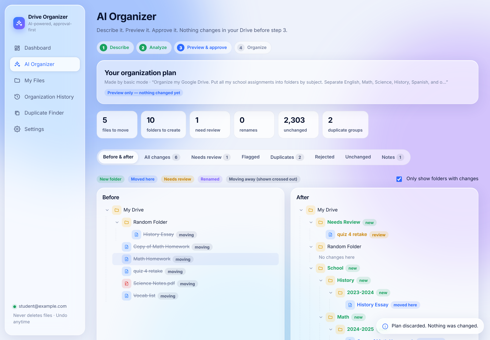

# AI Drive Organizer

Organize your Google Drive by describing what you want in plain English, for example:

> "Put all my school assignments into folders by subject. Separate English, Math, Science,
> History, Spanish, and other subjects. Within each subject, organize files by school year.
> Find duplicates and show them to me before doing anything with them. Don't delete anything."

The app scans your Drive, reads document contents when allowed, and builds a complete
**before-and-after preview**. Nothing changes until you approve it. Every operation is
recorded and can be **undone**.

It runs entirely in Chrome as a normal HTTPS website. There is nothing to install: no
extensions, apps, Python or Node, so it works on locked-down school laptops.



## Features

- **Google sign-in through Google's own page** (Google Identity Services, OAuth 2.0). The app never sees your password. The access token stays in memory only.
- **Full Drive scan with pagination and progress**: My Drive, nested folders, Docs, Sheets, Slides, PDFs, images, videos and everything else. Retries on rate limits. Items that are only "Shared with me" (not in My Drive) are left alone.
- **Natural-language planning** with Claude, through your own serverless backend that keeps the API key off the website. The AI only *proposes* JSON; it can't touch Drive.
- **Content-aware**: reads the beginning of Google Docs, Sheets, Slides, PDFs (via bundled pdf.js) and text files, read-only and cached, so it doesn't rely only on file names.
- **Needs Review** instead of guessing when a file's place is unclear.
- **Basic mode** (no AI) using names, types, dates and contents, for when no AI backend is configured or it's unavailable.
- **Preview and approval**: expandable before/after trees, a searchable list of every change with a checkbox each, plus tabs for needs-review, flagged, duplicate, rejected and unchanged files. Use **Approve & Organize** or **Cancel**.
- **Safe execution**: each file is re-checked right before it's touched. Folders are reused, never duplicated. Circular folder moves are blocked twice (at planning and against the live Drive). Name conflicts are flagged. Failures are recorded, never silently skipped. Runs can be stopped, and they pause (then resume) if Google's one-hour session expires.
- **Organization History and Undo**: per file or per run. Undo checks that the file is still where the app put it, that the original folder still exists, and that no same-named file is in the way, and asks you when something needs a decision. History is stored in the browser and backed up to the app's private Drive folder. It can also be exported and imported.
- **Duplicate Finder**: matches by MD5 content hash, by size, and by name ignoring "Copy of" and "(1)". It never deletes; you can gather chosen copies into a review folder, with the usual preview.
- **Liquid Glass UI**: translucent panels, light/dark/system theme, responsive layout.

## Safety rules (enforced in code and checked by the tests)

1. Never permanently deletes files. The Drive client has no delete method.
2. Never empties the trash.
3. Never overwrites files. Drive keeps same-named files side by side, and conflicts are flagged.
4. Never moves files without approval.
5. Never renames without approval, and only renames when you explicitly ask.
6. Never changes sharing permissions.
7. Never changes ownership.
8. Never modifies file contents.
9. Never creates circular folder structures.
10. Never silently skips a failed operation. Every success, skip and failure goes into History.

The only "trash" action is optional and part of Undo: after an undo, it can move
**empty** folders that the app itself created to the Trash, which Google keeps for 30
days. It's off unless you tick it.

## How it works

```
Chrome (static site on GitHub Pages)                   Cloudflare Worker (optional)
┌───────────────────────────────────────────┐          ┌─────────────────────────────┐
│ Google Identity Services → access token   │          │ verifies Google token was   │
│ Drive API v3 (scan, read, create, move)   │  plan    │ issued to this client ID    │
│ validate → preview → approve → execute    │ ───────▶ │ calls Claude (key = secret) │
│ IndexedDB history + appDataFolder backup  │ ◀─────── │ returns JSON proposal only  │
└───────────────────────────────────────────┘ proposal └─────────────────────────────┘
```

- `app/`: the website. No build step, plain ES modules.
  - `js/core/drive.js`: Drive API client (retries, backoff, the only write methods)
  - `js/core/scanner.js`, `driveIndex.js`: paginated scan and in-memory index
  - `js/core/content.js`: read-only text excerpts (Docs/Sheets/Slides export, PDF, text)
  - `js/core/ai.js`: talks to the AI backend in batches
  - `js/core/rules.js`: basic (non-AI) mode
  - `js/core/plan.js`: **validation** of every proposed operation, plus the before/after model
  - `js/core/executor.js`: runs approved operations with live re-checks
  - `js/core/undo.js`, `history.js`: history and undo
  - `js/ui/`: interface
- `worker/worker.js`: AI backend (single file, paste into the Cloudflare dashboard)
- `tests/`: automated tests (see below)

## Deploying

See **[docs/DEPLOYMENT.md](docs/DEPLOYMENT.md)** for step-by-step setup: Google Cloud
project, Drive API, OAuth consent screen and client ID, GitHub Pages, the Cloudflare
Worker, and troubleshooting.

## Using it (end user)

1. Open the site URL in Chrome and click **Connect Google Drive**.
2. Choose your Google account and allow the requested access.
3. Click **Organize My Drive** and type how you want things organized, or pick an example.
4. Click **Analyze & build preview**. This step only reads your Drive.
5. Review the before/after trees and the list of changes, and untick anything you don't want.
6. Click **Approve & Organize**. You can undo later in **Organization History**.

## Privacy

With AI mode on, the names, locations, dates, sizes and short text excerpts of the files
being organized go to your AI backend and on to Anthropic's API, so it can decide where
they belong. File contents are not otherwise uploaded anywhere. Turn off AI or "Read
document contents" in Settings to send less. Settings, history and cached excerpts stay
in your browser. History is also backed up to the app's private folder in your own Drive.

## Testing

```bash
npm test           # 27 unit/integration tests, Node 20+, no dependencies
npm run test:e2e   # real UI in headless Chromium (Playwright)
```

The tests use `tests/fakeDrive.js`, an in-memory imitation of the Drive v3 endpoints the
app uses, with pagination and injectable 401/403/429/5xx errors. It refuses DELETE,
empty-trash and permission calls, and the tests fail if any are attempted. Covered:
pagination (2,300 and 10,000 files), retries, token refresh, folder creation without
duplicates (including lost responses), nested moves, preview trees, approval, untick and
cancel, live re-checks, cycle protection, stop and resume after session expiry, undo
(conflicts, missing originals, renames, empty-folder cleanup), history backup and
restore, duplicate detection, content extraction (including real PDF text), the AI
client's batching, and the Worker's auth, CORS and output sanitizing. The e2e test clicks
through welcome → connect → scan → analyze → cancel → analyze → untick → approve →
history → undo → AI mode with an injected API failure → duplicates → files → dark mode →
disconnect.

**Not testable here:** a real Google sign-in and a real Drive account, which need your
OAuth client and Google account. Do the checklist in DEPLOYMENT.md §4 on the deployed
site with a test folder before organizing your whole Drive.

## Limitations

- **My Drive only.** Shared drives aren't organized. "Shared with me" items not added to My Drive are left alone.
- Word, PowerPoint and Excel files, and images, are classified from their names, types and dates. Their contents aren't read.
- Folder names that contain "/" can't be used as destinations.
- Google sessions last about an hour. Long runs pause and can be resumed after you reconnect.
- School-managed Google accounts may block third-party Drive apps (see DEPLOYMENT.md).
